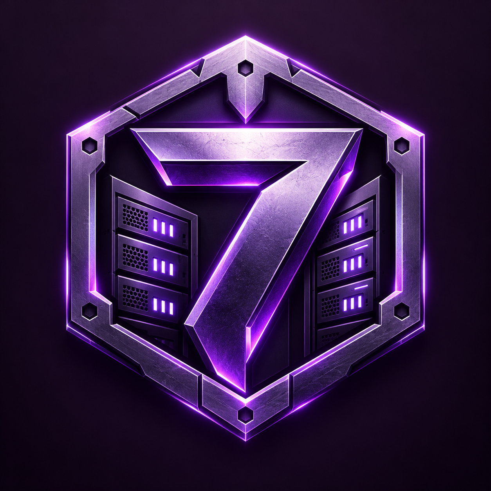
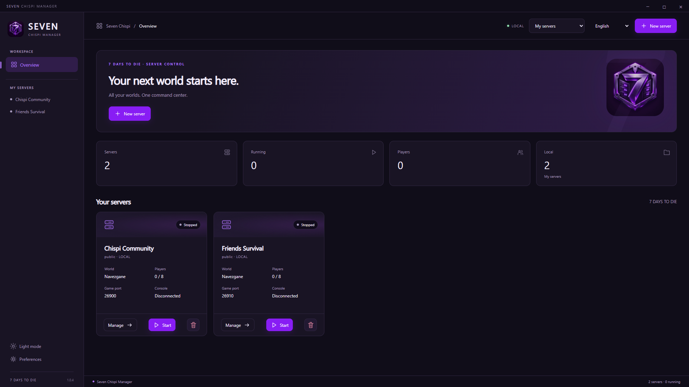
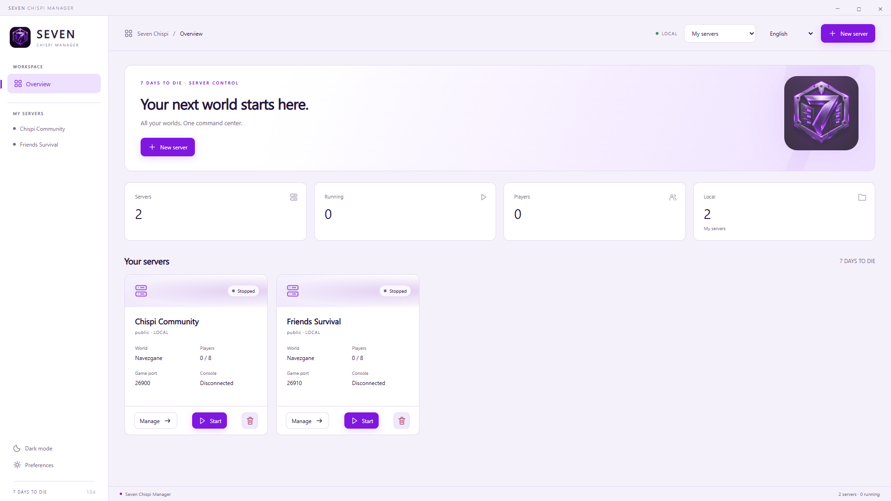
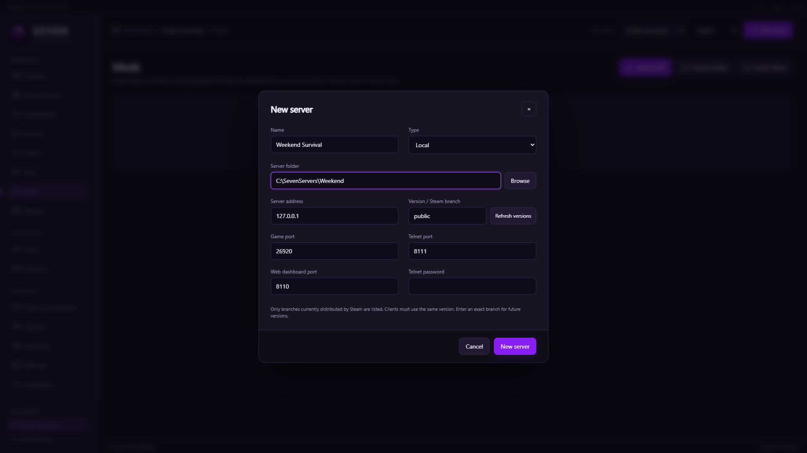
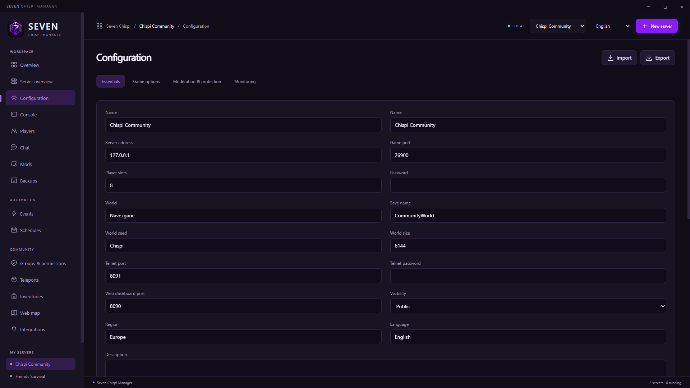
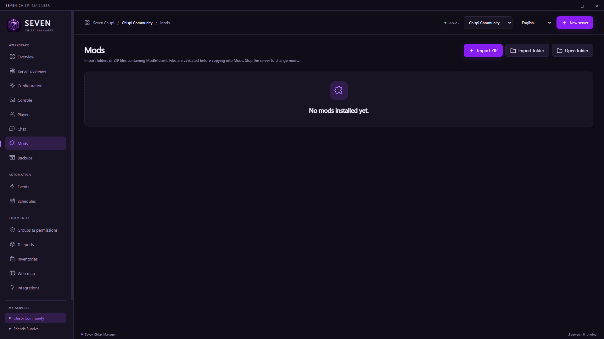

# Seven Chispi Manager

<p align="center"></p>

**A Windows desktop manager for multiple 7 Days to Die dedicated servers.** Create independent server profiles, choose a Steam branch, edit settings, install mods, manage backups, and keep everyday administration in one place.

> **Built with AI assistance.** ChatGPT and Codex were used extensively to develop the application, write and review code, prepare documentation, and assist with testing. The original logo was generated with OpenAI ImageGen. This is an independent community project; AI assistance does not guarantee correctness. See [AI and artwork disclosure](docs/BRAND.md) and [validation](docs/VALIDATION.md).

[Download Windows installer](https://github.com/Chispinela/seven-chispi-manager/releases/download/v1.0.5/Seven-Chispi-Manager-Setup-1.0.5.exe) · [Portable edition](https://github.com/Chispinela/seven-chispi-manager/releases/download/v1.0.5/Seven-Chispi-Manager-Portable-1.0.5.exe) · [All releases](https://github.com/Chispinela/seven-chispi-manager/releases)

## What you can do

- Host multiple local servers with separate folders, worlds, configurations, mods, ports, and backups.
- Install or update the official dedicated server through SteamCMD and select a branch currently offered by Steam.
- Start, save, stop, and restart servers; monitor their process CPU and memory use.
- Edit essential settings or the installed version's full XML options.
- Use the Telnet console, player administration, chat, events, schedules, groups, and teleports.
- Import mod folders or ZIP files, and enable or disable mods while the server is stopped.
- Create and restore backups. When deleting a server, keep its files by default or explicitly delete its folder.
- Switch between purple dark and light themes, with English, Spanish, Portuguese, Simplified Chinese, Japanese, and Russian interfaces.
- Configure optional Discord, SMTP, Steam VAC, inventory, and map integrations when their external requirements are available.

Rewards and voting sections have been removed from the interface. Historical records and some scripting actions remain for compatibility.

## Screenshots

Real application captures in English, at **1920 × 1080**, using fictional, stopped example profiles. No live-player statistics or configured integrations are shown. Click an image to view its full resolution.

### Dark theme and multiple servers



### Light theme



### Create a server



### Configuration



### Mod management



See [how the gallery was captured](docs/SCREENSHOTS.md).

## Install

1. Download the **Setup** executable from [Releases](https://github.com/Chispinela/seven-chispi-manager/releases/latest).
2. Run it and choose the installation folder. Use the portable executable if you prefer not to install the manager.
3. Open Seven Chispi Manager and choose **English** in the language selector if needed.

Requires Windows x64, an Internet connection to install game servers, and enough RAM and disk space for every server you host. Node.js is only needed to build from source. Game binaries, SteamCMD, mods, saved worlds, and credentials are not bundled in this repository or installer. SteamCMD is downloaded from Valve when required.

## Create your first server

1. Click **New server** and enter a name, such as `Weekend Survival`.
2. Choose **Local** and a dedicated folder, such as `C:\SevenServers\Weekend`. Give every local server its own folder.
3. Leave the server address as `127.0.0.1` for local management. Choose distinct game, Telnet, and web dashboard ports. The manager also reserves the adjacent game ports, so leave room between servers.
4. Enter a strong **Telnet password**. Keep Telnet reachable only from trusted management connections.
5. Click **Refresh versions** and choose the Steam branch you want. `public` selects the current stable version. Older names such as `alpha21.2` are available only while Steam distributes them; exact `1.0` or `2.0` branches are not guaranteed. Game clients and the server must use matching versions.
6. Click **New server**, then **Install / update** on the server overview. Wait for the installation to finish.
7. Open **Configuration**. Check the server name, player slots, world, save name, seed, visibility, password, and other options. Save your changes.
8. Click **Start**. The manager reports **Running** after the world has finished loading. Use **Console** to check output and send commands.
9. For another server, repeat these steps with another folder and non-overlapping ports. Router/firewall configuration for Internet players depends on your own network and is not automatically configured.

For a remote profile, provide an existing server's address, Telnet port, and password. Remote administration does not install files or start a process on another PC.

## Mods, backups, and deletion

**Mods:** stop the selected server, open **Mods**, and select **Import ZIP** or **Import folder**. The package must contain `ModInfo.xml`. Choose mods compatible with the server branch and install required client-side mods separately.

**Backups:** use **Backups** while the server is stopped. Scheduled backups stop the local server, back it up, and restart it. Restore requires a matching branch and preserves previous data in `before-restore` folders. Backups do not duplicate the complete dedicated-server installation.

**Delete server:** stop it first and click the delete button. **Keep files** is selected by default and removes only the manager profile. **Delete files too** permanently removes the displayed server folder, including worlds, mods, and configuration. Backups outside that folder remain.

Normal profiles are stored under `%APPDATA%\Seven Chispi Manager`. Closing the window can leave the manager in the system tray; scheduled actions require it to remain open. Profile credentials use Windows DPAPI, while game XML files and backups can still contain credentials required by the game.

## Build from source

Use Windows x64 and Node.js 24 or later:

```powershell
npm ci
node node_modules/electron/install.js
npm test
npm start
npm run build
```

The installer, portable executable, and unpacked application are written to the version folder under `output/`. To reproduce the English gallery after building, run `npm run screenshots`. To produce a source archive, run `node tools/source-archive.cjs`.

The repository includes application code, six translations, original artwork, tests, build helpers, and documentation. Runtime profiles, credentials, game installations, private logs, and generated binaries are excluded from source control. Download compiled binaries from Releases; verify them against the included `SHA256SUMS.txt` if desired.

## Compatibility and project status

Local hosting, simultaneous servers, Telnet, world loading, saving, shutdown, and backups were exercised with the official **V3.4.0 b9** dedicated server. The current automated suite contains **52 tests**. External Discord/SMTP accounts, VAC keys, mod APIs, Internet connectivity, and real-client multiplayer have not all been validated. See [features and requirements](docs/FEATURES.md), [event scripting](docs/EVENTS.md), and [validation details](docs/VALIDATION.md) before relying on an integration.

This project has its own event language and JSON formats. It is not a drop-in RATScript interpreter or a RAT database importer. RAT executables, libraries, artwork, and source are not redistributed.

## License and credits

Application source is provided under the [MIT License](LICENSE). Third-party dependencies retain their respective licenses; original AI-generated artwork is identified in [BRAND.md](docs/BRAND.md). 7 Days to Die and related trademarks belong to their respective owners. This project is not affiliated with or endorsed by The Fun Pimps or Valve.

**AI disclosure: this project was developed with extensive ChatGPT/Codex assistance, and its logo was generated using OpenAI ImageGen.**
